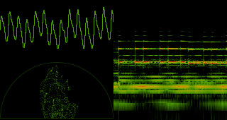
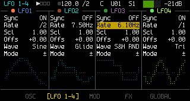
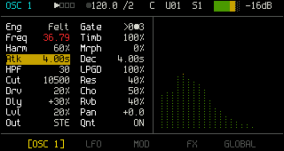

# Dronage 0

A drone synthesizer for the M5Stack CardputerZero.

Four macro oscillator voices, eight LFOs, a modulation matrix, a modulation
sequencer, euclidean gates, delay, reverb, tape dirt and a compressor, with
scenes, undo, microtonal scales, colour themes, WAV recording and a page of
full-screen visualizers.





## Install

From the CardputerZero store: search for **Dronage 0**, or enter the share
code **DRNG**.

By hand, with the `.deb` from this repository:

```
sudo dpkg -i dronage-zero_3.5.1-1_arm64.deb
```

## Keys

| Key | Action |
|---|---|
| 4 5 6 7 8 | screens: OSC, LFO, MOD, FX, GLOBAL (press again for the next page) |
| 1 2 | previous, next page of the current group |
| F Z X C | move the cursor |
| K N | value up, down (coarse) |
| M B | value up, down (fine) |
| Q W E R | start and stop voices 1 to 4 |
| U I O | macro down, stop, up |
| A S | undo, redo |
| Enter, Space | toggle |
| Del | reset the value |
| Fn + 1 to 8 | scenes |
| Fn + 9 | record |
| Fn + 0 | randomize what the cursor is on |
| Ctrl + S, O | save, load |
| H | key list |
| Esc | menu |

Press 8 twice for the visualizers, then Z and C to step through them.

Projects, recordings, user scales and themes are kept in `~/Dronage`.

## License

Licence: [EULA.txt](EULA.txt) and
[THIRD-PARTY-LICENSES.txt](THIRD-PARTY-LICENSES.txt).
